# Animated examples

These [animated SVGs](glossary.md#animated-svg) were exported from example diagrams that ship with
[illustrate](skills/illustrate.md). Each one uses a different [arrow style](glossary.md#arrow-style).
They play in a README with no script, and show the still figure to readers who ask for
[reduced motion](glossary.md#reduced-motion).

To reproduce one, run the command from the repository root. The output lands next to the HTML.

## draw: arrows draw on, then stop



Each arrow draws from its source to its tip, then its arrowhead appears. It ends on the complete
figure.

```bash
python skills/illustration-tools/skills/illustrate/scripts/export_diagram.py docs/media/example-sequence-oauth.html --animated --arrows=draw
```

Editable source: [example-sequence-oauth.html](media/example-sequence-oauth.html)

## flow: moving dashes



Each arrow becomes dashes that keep moving toward the tip. It loops.

```bash
python skills/illustration-tools/skills/illustrate/scripts/export_diagram.py docs/media/example-lead-intake.html --animated --arrows=flow
```

Editable source: [example-lead-intake.html](media/example-lead-intake.html)

## pulse: a dot travels each arrow



A dot rides along each arrow in its direction. It loops.

```bash
python skills/illustration-tools/skills/illustrate/scripts/export_diagram.py docs/media/example-state.html --animated --arrows=pulse
```

Editable source: [example-state.html](media/example-state.html)

## chevrons: chevrons slide along



Small chevrons slide along each arrow. It loops.

```bash
python skills/illustration-tools/skills/illustrate/scripts/export_diagram.py docs/media/example-state-lifecycle.html --animated --arrows=chevrons
```

Editable source: [example-state-lifecycle.html](media/example-state-lifecycle.html)

## draw-flow: draw on, then keep flowing



Arrows draw on like `draw`, then a slow accent dash keeps flowing. It loops after the draw.

```bash
python skills/illustration-tools/skills/illustrate/scripts/export_diagram.py docs/media/example-flowchart.html --animated --arrows=draw-flow
```

Editable source: [example-flowchart.html](media/example-flowchart.html)

## Sizes

| File | Arrow style | Size |
| --- | --- | --- |
| `example-sequence-oauth.animated.svg` | `draw` | 17 KB |
| `example-lead-intake.animated.svg` | `flow` | 8 KB |
| `example-state.animated.svg` | `pulse` | 10 KB |
| `example-state-lifecycle.animated.svg` | `chevrons` | 15 KB |
| `example-flowchart.animated.svg` | `draw-flow` | 12 KB |

## Make your own

- Ask the skill: "export it as an animated SVG with pulsing arrows".
- For a GIF, use `--gif` instead of `--animated`. Add `--theme dark` or `--fps 10` if needed. GIFs
  need Playwright and Pillow, and cannot follow reduced motion.
- Embed the file like any image. Write alt text that describes the complete figure, and keep the
  HTML source beside it.

## Related

- [illustrate](skills/illustrate.md)
- [Product map](product-map.md), which embeds its own animated diagram
- [Glossary](glossary.md)
