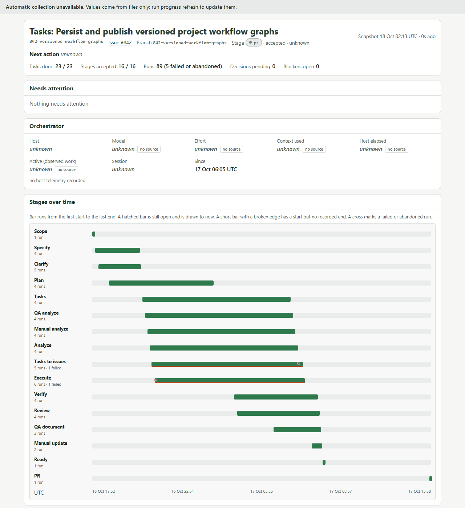
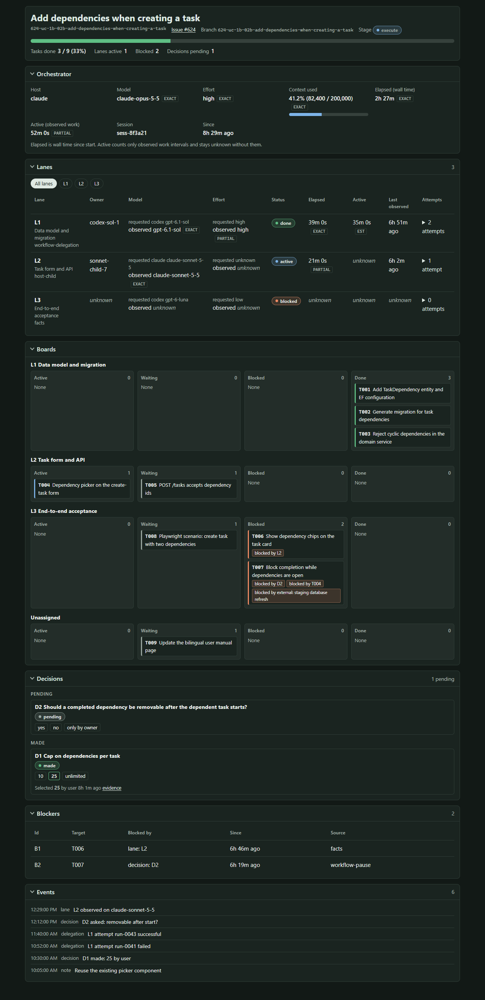
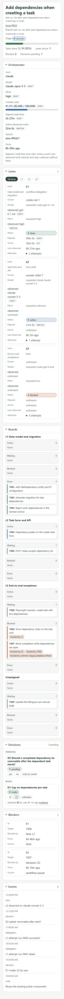

# progress-report

A live progress report for a plan or a Spec Kit feature: which lanes run which tasks, what is blocked, which decisions
are open, and what the orchestrating agent is using. The report is a deterministic projection. It is rebuilt from the plan
or `tasks.md` and from the host's native hook payloads, so no agent is spent keeping it up to date.



Contents: [Install](#install) · [Quick start: plan mode](#quick-start-plan-mode) ·
[Quick start: Spec Kit mode](#quick-start-spec-kit-mode) · [Hooks](#hooks) · [Commands](#commands) ·
[What the report shows](#what-the-report-shows) · [What is measured](#what-is-measured-and-how-well) ·
[Files](#files) · [Theming](#theming) · [Token cost](#token-cost) · [Troubleshooting](#troubleshooting) ·
[Limits](#limits)

A **lane** is one unit of assignment: a worker, a delegated run or a host subagent that owns a list of tasks. A
**projection** is a report rebuilt from its sources on every refresh, so deleting it loses nothing. A **plan** is any
Markdown file with `- [ ]` / `- [x]` items.

## Install

Requires Python 3.11 or later and git. Nothing else: the code uses only the standard library, and the report is static
HTML. Spec Kit is optional.

`progress-report` ships in the [sanduq-skills](https://github.com/samykabu/sanduq-skills) `agent-tools` plugin bundle.

```text
/plugin marketplace add samykabu/sanduq
/plugin install agent-tools@sanduq
```

Or install just this skill into the current project:

```bash
npx skills add samykabu/sanduq-skills --skill progress-report            # Claude Code: .claude/skills/
npx skills add samykabu/sanduq-skills --skill progress-report -a codex    # Codex: .agents/skills/
```

Where it lands decides where the script is. In this page `progress` stands for
`python <skill dir>/scripts/progress.py`, run from the repository root, where `<skill dir>` is one of:

```text
.claude/skills/progress-report                       npx skills install for Claude Code
.agents/skills/progress-report                       npx skills install for Codex
$CLAUDE_PLUGIN_ROOT/skills/progress-report           plugin install
```

The skill writes nothing to a project until you run `init`.

## Quick start: plan mode

Plan mode needs no Spec Kit. Any Markdown checklist is a plan: a file you wrote, or a plan your agent saved, for example
`~/.claude/plans/refactor.md`.

1. Install the hooks once, so the report learns the model, effort, context and child agents ([details](#hooks)).

   ```bash
   progress hooks install --host claude        # or --host codex; add --scope user for a plugin install
   ```

   Without hooks the report still follows the plan and your recorded facts. Hooks first, because a bind needs a hook to
   complete it.
2. Create the report.

   ```bash
   progress init --plan docs/plan.md
   ```

   ```text
   progress: ready .progress/plan/.view/index.html bind=0b04e35005e9
   ```

   The report lives in `.progress/plan/` (`--name` and `--dir` change that). The `bind=` value binds the current session:
   the host's next hook for that shell call completes it. Created the report first? Run `hooks install` afterwards: it
   prints a fresh `bind=` for the one existing report, and the next tool call completes it.
3. Open `.progress/plan/.view/index.html` in a browser. It works from `file://`, needs no server and polls for new data
   every 3 seconds.
4. Assign work. Items show the ids the plan gives them (`T001`) or the stable ones Progress adds (`P001`):

   ```bash
   progress lane L1 --tasks P001-P003 --owner worker-a --label Core --harness codex --model gpt-6.1-sol --effort high
   ```

   ```text
   progress: L1 open 3 tasks
   ```

5. Work as usual and check items off **in the plan file**. Progress only reads it. Ask for the one-line state any time:

   ```text
   progress: 4/12 tasks, 1 lanes active, 0 blocked, 0 decisions pending (rev 15)
   ```

**What a plan can contain.** Every `- [ ]` / `- [x]` item is a task (nested items too). A heading of level 2 or deeper is
the phase of the items under it, and the first level-1 heading is the title. `(depends on T001, P002)` and `(after T001)`
add dependencies; `[P]` marks a parallel item. Fenced code blocks and inline code spans are ignored.

**Ids.** An item that starts with an id keeps it (`T001`, `US3`, `T-12: title`, `**T001**: title`); words such as MP3, GPT-4,
Q3, ES6, X11, H264 and RFC-7231 are text, and a repeated id makes the later item an automatic one. Every other item gets `P001`,
`P002`, ... in plan order the first time, and keeps that id afterwards: the tracked `plan.json` stores each id with a
one-way fingerprint of its text (never the text), and an edit is matched by equal text first, then by text at least 60
percent similar (using the text kept in the git-ignored `.host/plan-keys.json`), and only then gets a new number. Reordering, checking off and small rewordings change nothing; numbers are never reused. The full rule is in
[commands](docs/commands.md#plan-mode).

**Which plan.** When one plan or feature is active, no flag is needed. Otherwise pass `--plan NAME|PATH` (a name, a
report directory or the plan file) or `--feature DIR`; without one the verb prints
`progress: error PROGRESS_NO_FEATURE pass --plan NAME or --feature DIR (candidates: plan:launch, specs/001-demo)`.

**A plan outside the repository** is read in place. The tracked files store `external:<file name>`, never the absolute
path, which stays in the git-ignored `.progress/<name>/.host/plan-source.json` with a fingerprint of the full path. Running
`init` with a different file of the same name is refused; pass `--rebind` to follow it.

## Quick start: Spec Kit mode

1. Create the task list with Spec Kit's `tasks` step. Progress reads `specs/<feature>/tasks.md` (`- [ ] T001 [P] Title
   (depends on T000)`), and the Workflow checkpoint, delegation ledger and decisions when
   [Sanduq Workflow](https://github.com/samykabu/sanduq) is installed.
2. Create the report.

   ```bash
   progress init --feature specs/001-demo
   ```

   ```text
   progress: ready specs/001-demo/progress/.view/index.html bind=0b04e35005e9
   ```

3. Register the hooks. In a Spec Kit project the [Sanduq extension](https://github.com/samykabu/sanduq) vendors this
   skill and registers the five hooks through Spec Kit's event dispatcher, together with the
   `speckit.progress.*` commands (`$speckit-progress-init` in Codex, `/speckit-progress-init` in Claude Code). Do not also run
   `progress hooks install` there: it detects those hooks and refuses (exit 3) so no event is recorded twice.
4. Record lanes, blockers, decisions and notes with the verbs below; check tasks off in `tasks.md`.

Everything in the rest of this page applies to both modes. A feature report lives in `specs/<feature>/progress/`; a
plan report in `.progress/<name>/`.

## Hooks

```bash
progress hooks install   --host claude|codex [--scope project|user]
progress hooks uninstall --host claude|codex [--scope project|user]
progress hooks status    [--host claude|codex]
```

`install` writes the host's native hook entries for `session_start`, `pre_tool_use` (matcher `Task|Agent|spawn_agent`, the
subagent launches), `post_tool_use`, `stop` and `session_end`, each calling `scripts/hook.py`. The Claude entries go to
`.claude/settings.json`; the Codex entries to `.codex/hooks.json` (no session end). `--scope user` writes
`~/.claude/settings.json` or `~/.codex/hooks.json` instead.

- Existing settings and hooks are preserved. Every entry carries `--managed-by=progress-report`, and `uninstall` removes
  only those.
- Project scope writes a repo-relative command, never an absolute path. If the skill is outside the repository (a plugin
  install), use `--scope user`.
- Every command ends in `; exit 0`, so a script that vanished (a plugin updated or pruned) cannot block the host.
  `status` flags such entries (`user 5/5 (5 script missing)`). Run `hooks uninstall --scope user` before updating or
  removing the plugin, then install again.
- Installing in the other scope when this installer's entries already exist there is refused; pass `--force-both`.
- `--python` takes one command word; a value with spaces is refused (put the interpreter on PATH).
- The hook file is edited under a lock and only if it did not change meanwhile: a change is re-read once, a second one
  refuses with `PROGRESS_HOOKS_CONFLICT`. A symlinked settings file is refused with `PROGRESS_UNSAFE_TARGET`.
- Nothing is written for a host you do not name. `status` only reads.
- Codex hooks are experimental and the `hooks.json` shape for Codex is **unverified** against a running host; see
  [hosts](docs/hosts.md).

```text
$ progress hooks install --host claude
progress: hooks installed claude project 5 entries in .claude/settings.json
$ progress hooks status
progress: hooks claude project 5/5 user 0/5; codex project 0/4 user 0/4; spec-kit no
```

A hook prints nothing and always exits 0. It attaches an event only to a bound session (the `bind=` handshake from
`init`), so unrelated sessions in the same repository are ignored.

## Commands

| Verb | Use |
| --- | --- |
| `init [--plan PATH [--name N] [--dir D] \| --feature DIR] [--statusline yes\|no] [--theme P]` | Create the report, start the bind handshake |
| `bind [--session ID] [--host H]` | Bind this session when `init` was run elsewhere |
| `refresh [--verbose]` | Rebuild the report now; silent on success |
| `status [--json]` | One-line state, or the projection |
| `lane L1 --tasks P001-P004 [--owner ID] [--label T] [--harness H --model M --effort E] [--close]` | Assign tasks to a lane |
| `block P007 --by L2\|P003\|SD2\|ext:"text"` and `unblock B4` | Record and resolve a blocker |
| `decide ask "q" --options a,b` and `decide made D2 b --by user` | Questions and answers (refused when Workflow owns decisions) |
| `note "text" [--target P005]` | A retry or failure worth a human's attention |
| `attempt record`, `runs [--json]` | Integration verbs for Workflow and `.delegate/runs` |
| `theme --preset NAME \| --from-illustrate \| --file F \| --show` | Colours, block order, density, title, logo |
| `export [--format md\|json] [--out PATH]` | Deterministic Markdown or JSON of the projection |
| `hooks install\|uninstall\|status` | Native host hooks, above |
| `statusline [install\|uninstall]` | Claude Code status line wrapper |
| `hook EVENT` | Internal: what the host's hooks call |

Every verb that works on one report also takes `--plan NAME|PATH` or `--feature DIR` (put them before a sub-action such as
`ask`). Verbs print one line starting `progress:`. Exit codes: 0 done, 2 usage or not found, 3 refused, 4 lock busy.
Every flag, output line, exit code and JSON schema is in [the command reference](docs/commands.md).

## What the report shows

Each block can be hidden or reordered in [the theme file](#theming).

| Block | Shows | Comes from |
| --- | --- | --- |
| Header | Title, id, plan file or issue link, branch, Workflow stage, a progress bar, and counts of tasks done, lanes active, blocked and decisions pending | The plan or `tasks.md` heading and checkboxes; git branch; the Workflow checkpoint |
| Orchestrator | Host, model, effort, context used (gauge), elapsed time, session id | Host hooks and, on Claude Code, the status line. Each value shows its fidelity |
| Lanes | One row per lane: owner, requested and observed model and effort, status, elapsed, active time, last observed, attempts. A filter narrows the boards to one lane | `lane` facts; Workflow delegation attempts; host child agents (`C1`, `C2`, ...) |
| Boards | Tasks grouped as Active, Waiting, Blocked and Done, per lane, plus an Unassigned board | Plan or `tasks.md` checkboxes; open blockers; the lane that owns each task |
| Decisions | Pending questions with their options, and made decisions with who decided and an evidence link | `decide` facts, or the Workflow ledger |
| Blockers | Id, blocked task or lane, what blocks it, since when, source | `block` facts; Workflow pauses; delegation state |
| Events | The last 30 derived events: lane changes, attempts, notes, subagent starts | The other sources, in time order |

Lane status is one of `pending`, `active`, `waiting`, `blocked`, `done` or `failed`. A task is Active when it is the
first unchecked, unblocked task of an active lane. Checking the box in the plan or `tasks.md` is the only thing that
completes a task.

Two banners sit above the report:

- **Stale.** Shown when the last refresh is older than `stale_after_seconds` (600 by default), or when updates are
  pending inside the 5-second debounce window. It means the page is behind the project, not that anything failed.
- **Automatic collection unavailable.** Shown when no host has reported yet. Values come from files only. Run
  `progress refresh` to update them.

A failed load shows **Update failed** and keeps the last good view.

## What is measured, and how well

Every measured value carries its source and fidelity. Unknown is shown as unknown and is never filled with a guess.

| Fact | Claude Code | Codex |
| --- | --- | --- |
| Task state, dependencies | Exact, from the plan or `tasks.md` | Exact |
| Lane, blocker, decision, note | Exact, recorded by verb | Exact |
| Model | Exact from the status line when installed; partial from hooks | Partial, from the rollout file |
| Effort | Exact from hook and status line payloads where the host sends it | Partial, from the rollout file |
| Context use | Exact from the status line | Partial, from the rollout file |
| Elapsed | Session duration from the status line; otherwise estimated from the report start | Estimated |
| Active work time | Unknown. Hosts give no interval evidence, so it is never inferred | Unknown |
| Child agents | Started on launch, ended on a terminal tool result; a background child stays running until a stop payload names it | Parent links when the payload has them; otherwise dropped and counted |
| Observed child model | Only when the payload carries it | Only when the payload carries it |

Codex field names are partly unverified against a running host; see [hosts](docs/hosts.md). A session is bound to a
report by an explicit handshake, so hooks never attach an observation to a guessed report.

## Files

```text
.progress/<name>/                  plan report (default; --dir picks another directory inside the repository)
  facts.jsonl      tracked in git: lanes, blockers, decisions, notes, legacy attempts
  plan.json        tracked: name, plan reference (repo-relative or external:<name>), stable item ids with text fingerprints
  .host/           git-ignored, durable: host snapshots; plan-source.json (external plan path), plan-keys.json (item text)
  .view/           git-ignored, disposable: the report (index.html, data.js, report.json, theme.css, state.json, lock)
specs/<feature>/progress/          Spec Kit report: facts.jsonl, .host/, .view/ (tasks come from ../tasks.md)
.progress/plans.json               tracked, only when a --dir outside .progress/ is used
.specify/progress/                 project state in a Spec Kit project; .progress/.project/ everywhere else
  config.json      debounce_seconds (5), stale_after_seconds (600), status line state
  theme.json       optional theme
  bindings.json    session bindings (local, git-ignored)
  diagnostics.log  hook problems (local, git-ignored)
```

`facts.jsonl` and `plan.json` are the files you commit. Lines of `facts.jsonl` are appended and never rewritten. Delete
`.view/` at any time: `progress refresh` rebuilds it, and child agent ids survive because they live in `.host/`. `init`
adds the git-ignored paths to `.git/info/exclude`, never to a tracked `.gitignore`. A write never goes through a symbolic
link or junction (`PROGRESS_UNSAFE_TARGET`), and a plan report directory must stay inside the repository. The layout and
every schema are in [contracts](docs/contracts.md).

## Theming

Four presets (`sanduq`, `cobalt`, `emerald`, `classic`) in light and dark, tokens only. `--from-illustrate` maps the
project's [Illustrate](../../../illustration-tools/skills/illustrate/SKILL.md) theme. Block order, hidden blocks, density,
title, logo and fonts are set in the project's `theme.json`.





```bash
progress theme --preset cobalt
```

The schema and a full example are in [the command reference](docs/commands.md#theme-verb-and-theme-file).

## Token cost

The benchmark replays a 55-update, 24-task, four-lane trace and counts the model-visible content each approach needs.
Counts use `o200k_base`, which is exact for that encoding; Claude figures are unverified because no exact local Claude
tokenizer exists.

| Approach | Updates | Setup |
| --- | ---: | ---: |
| Progress verbs | 2,433 | 910 |
| Hand-edited Markdown report | 59,967 | 581 |

Task start, completion and reopening cost nothing because they are read from the plan or `tasks.md`. The skill is the
setup cost you pay on each load, so it stays short. The full table by update class and the assumptions are in
[the token benchmark](docs/token-benchmark.md). Plan mode prints the same one-line outputs as feature mode, so the
benchmark applies to both. Measured usage from real harness runs comes from `scripts/live_ab.py`, a manual tool that
spends tokens ([details](docs/commands.md#benchmarks)).

## Troubleshooting

### Report is not updating

Work through these in order.

1. **Read the banner.** `Stale` with pending updates means events arrived inside the 5-second debounce window and the
   next event, `stop` or `progress refresh` publishes them. `Stale` with a time means nothing has refreshed for
   `stale_after_seconds`: the session ended, or the hooks are not reaching Progress. `Automatic collection unavailable`
   means no host has reported for this report.
2. **Force a refresh.** `progress refresh --verbose` prints `progress: refreshed rev N`. If the page changes, files and
   facts are fine and the problem is collection.
3. **Check the binding.** Hooks only attach to a bound session. Look in `diagnostics.log` in the project directory
   (`.specify/progress/` or `.progress/.project/`) for a line such as `unbound claude session s1 dropped`. Fix it by
   running `progress init` or `progress bind` through the shell tool in that session; the next tool call completes the
   bind within 120 seconds. `progress bind --session ID` binds directly when you know the id.
4. **Check the hooks are installed.** `progress hooks status` shows the count per host and scope. Install with
   `progress hooks install --host claude` (it prints a fresh `bind=` when a report exists). In a Spec Kit project the hooks come from the Sanduq extension and status says
   `spec-kit yes`.
5. **Check the host trusts them.** Hosts ask you to review project hooks before running them. If you declined, or the
   prompt never showed, they do not run. Claude Code's `disableAllHooks: true` switches them all off. Codex hooks sit
   behind a feature flag in the Codex configuration.
   **Codex also needs the project trusted and every hook approved** (including for `codex exec`); unapproved hooks are
   skipped silently. `progress hooks status --host codex` shows `registered` and `approved` counts and `project
   untrusted`; approve the hooks in Codex (an edited hook may need approving again). See [hosts](docs/hosts.md).
6. **Check the plan.** Items are lines such as `- [ ] Title` or `- [ ] T001 Title`. An item or id inside a code span or
   fenced block is ignored, and dependencies come only from `(depends on T001)` or `(after T001)`. If the plan lives
   outside the repository and the report shows no tasks, run `progress init --plan PATH` again to restore the local path.

### Diagnostics logs

Hooks and verbs never print errors to the host. They write them to bounded logs (256 KB, one rotated copy
`diagnostics.log.1`):

| File | Holds |
| --- | --- |
| `diagnostics.log` in the project directory | Dropped hook events: unbound session (logged once per id), empty or invalid payload, payload without a session id, `cwd` outside the bound worktree, handler errors, status line errors |
| `<report>/.view/diagnostics.log` | Per-report problems: lock busy (observation dropped), theme unavailable (fallback CSS written), report files not found, host snapshot migration skipped |

The projection counts the lines in the second file as `collection.diagnostics`.

### Error codes

Every verb error is one line, `progress: error CODE message`, and the exit code below.

| Code | Exit | Meaning and fix |
| --- | ---: | --- |
| `PROGRESS_USAGE` | 2 | Bad arguments or values. The message names the problem |
| `PROGRESS_NO_FEATURE` | 2 | No report found, several candidates, or a path that leaves the allowed place. Pass `--plan NAME` or `--feature DIR`; the line lists the candidates |
| `PROGRESS_NOT_INITIALIZED` | 2 | The report has no directory yet. Run `progress init` |
| `PROGRESS_NOT_FOUND` | 2 | The blocker or decision id does not exist or is not open |
| `PROGRESS_PLAN_MISSING` | 2 | `init --plan` was given a file that does not exist |
| `PROGRESS_THEME_INVALID` | 2 | Unknown preset, bad theme file, missing Illustrate theme. The message says which |
| `PROGRESS_THEME_UNAVAILABLE` | 2 | The theme module failed to load; a fallback `theme.css` was written. Reinstall |
| `PROGRESS_DECISION_AUTHORITY` | 3 | Workflow owns decisions for this feature. Answer in Workflow |
| `PROGRESS_FORBIDDEN_CONTENT` | 3 | The text looks like a secret, holds an absolute path outside the repository, or the `--actor` is not `user`, `hook`, `legacy` or `agent:<id>` |
| `PROGRESS_UNSAFE_TARGET` | 3 | A symbolic link or junction sits where Progress would write. Remove it |
| `PROGRESS_PLAN_EXISTS` | 3 | The report directory already follows a different plan (or a different file of the same name). Pass `--name` or `--dir`, or `--rebind` |
| `PROGRESS_DIR_CONFLICT` | 3 | `--dir` holds a `plan.json` or `facts.jsonl` that is not a Progress plan report. Pick another directory; nothing was written |
| `PROGRESS_EXCLUDE_FAILED` | 3 | git does not ignore the report's `.view/` and `.host/` after `init` wrote the exclusions. Pick another `--dir` |
| `PROGRESS_HOOKS_SPECKIT` | 3 | Spec Kit already registers Progress hooks for that host. Keep using them, or remove them first |
| `PROGRESS_HOOKS_SETTINGS` | 3 | The host's hook file is not valid JSON or has an unexpected shape. Fix it; it was not touched |
| `PROGRESS_HOOKS_PATH` | 3 | Project scope needs the skill inside the repository. Use `--scope user` or copy the skill in |
| `PROGRESS_HOOKS_DUPLICATE` | 3 | This installer's entries already exist in the other scope. Uninstall there, or pass `--force-both` |
| `PROGRESS_HOOKS_CONFLICT` | 3 | The hook file changed twice while it was edited, or another installer holds its lock. Retry |
| `PROGRESS_UNSAFE_TARGET` (hooks) | 3 | The hook file is a symlink (common with dotfiles). Install into the real file's directory or replace the link |
| `PROGRESS_LOCK_BUSY` | 4 | Another Progress process holds the report lock after 3 tries 200 ms apart. Retry once |

Hooks and the status line never fail: they drop the event, log it and exit 0.

## Limits

- Active work time is always unknown. Hosts give no interval evidence, and Progress does not infer it.
- Codex payload fields, the Codex `hooks.json` shape and the delivery of a background child's `stop` event are unverified
  against a running host ([hosts](docs/hosts.md)). A child with no terminal evidence ages into `waiting`; it is never
  marked done.
- Token counts for Claude models are unverified. The benchmark counts a different encoding.
- The plan or `tasks.md` owns task text and state. Progress never writes to it, so a task is done only when its box is
  checked.
- Auto ids follow the matching rule above. A rewrite beyond recognition makes a new id, and lane assignments to the old
  one no longer apply.
- The page reads local files. It makes no network request and needs a browser with JavaScript.

## Tests

```bash
python -m unittest discover -s skills/agent-tools/skills/progress-report/tests -q
```

Standard library only. The browser tests need Playwright with Chromium and skip cleanly without it; the token-budget test
needs `pip install tiktoken==0.14.0` and skips without it.

## Contract and hosts

[Commands](docs/commands.md) is the user reference. [Contracts](docs/contracts.md) are normative.
[Hosts](docs/hosts.md) records how each host calls the hooks and what it sends. The skill page for agents is
[SKILL.md](SKILL.md).

## License

MIT; see [LICENSE](../../LICENSE).
